# TokenTool

macOS 顶部菜单栏 AI 用量监控工具，实时查看 **Qoder**、**WorkBuddy**、**Codex**、**Claude Code**、**Trae** 的额度与剩余用量。

无 Dock 图标、无后台常驻窗口，点击菜单栏即可展开详情，也可以按全局快捷键 `⌥⇧T` 随时开合；五家平台可独立控制是否显示在菜单栏、菜单栏有三种显示样式可切换，并可直接打开对应客户端或官网，还支持每日领取与额度重置提醒。需要留意的事情会直接在菜单栏和面板顶部显示，不依赖系统通知。项目以 **MIT** 协议开源，并内置版本检查与「校验通过后一键安装并重启」。

当前版本：**1.8.0**（build 24） · 许可证：[MIT](LICENSE) · 源码：[GitHub](https://github.com/pumf/token_tool) · 宣传站：[tokentool-19u6gg8f8fg.qoder.zone](https://tokentool-19u6gg8f8fg.qoder.zone)

## 界面预览

> 以下截图使用演示数据，不含真实账号与用量；实际套餐、数值与重置时间随账号而变。面板为真实视图的离屏渲染；菜单栏条按应用同一套字体与配色渲染（应用本身无法截取系统菜单栏）。

| 面板（浅色） | 面板（深色） |
| --- | --- |
| 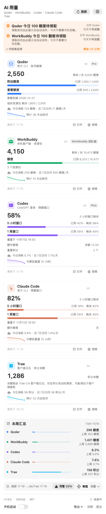 | 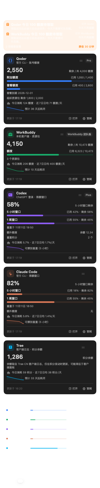 |

| 简单模式（浅色） | 简单模式（深色） |
| --- | --- |
| 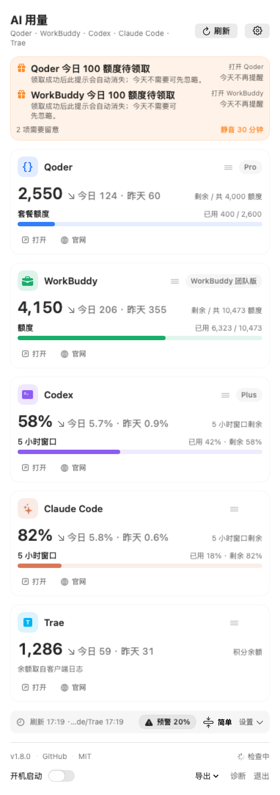 | 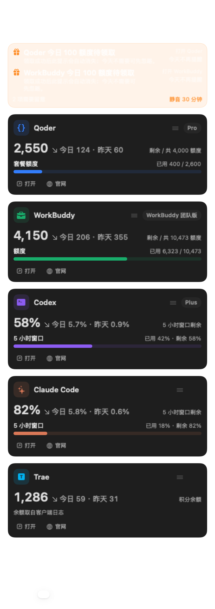 |

| 极简模式（浅色） | 极简模式（深色） |
| --- | --- |
|  | 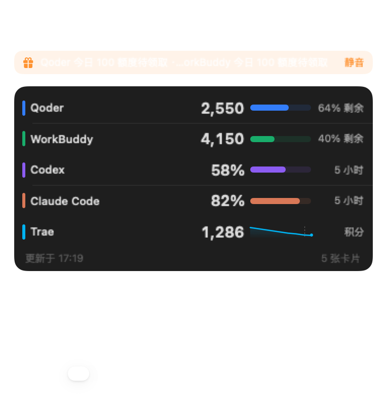 |

| 设置面板 | 额度告警 |
| --- | --- |
| 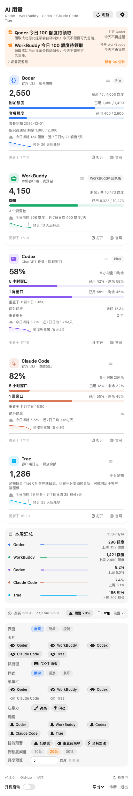 | 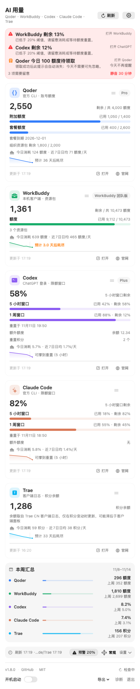 |

菜单栏文字随状态变化：正常、低额度告警（红 `⚠`）、今日待领取（橙 `＋`）、告警闪烁的暗帧，以及菜单栏平台全部关闭时的 `AI` 入口。

| 菜单栏（浅色） | 菜单栏（深色） |
| --- | --- |
| 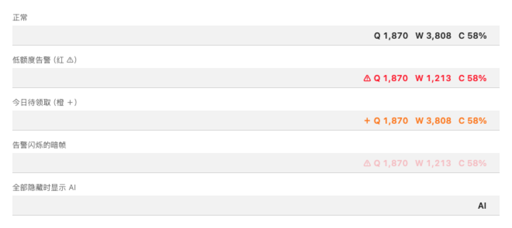 | 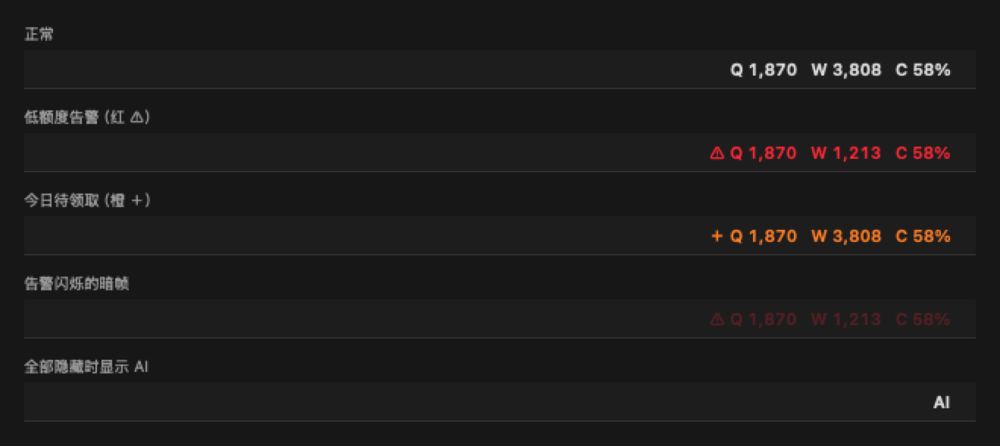 |

菜单栏有三种样式，可在设置区「样式」一行切换，状态本地保存：

| 样式（浅色） | 样式（深色） |
| --- | --- |
| 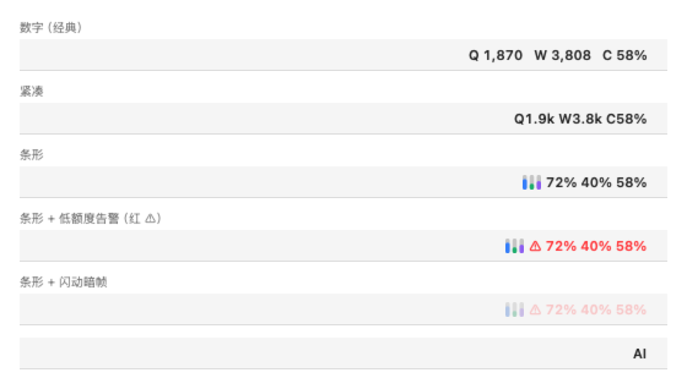 | 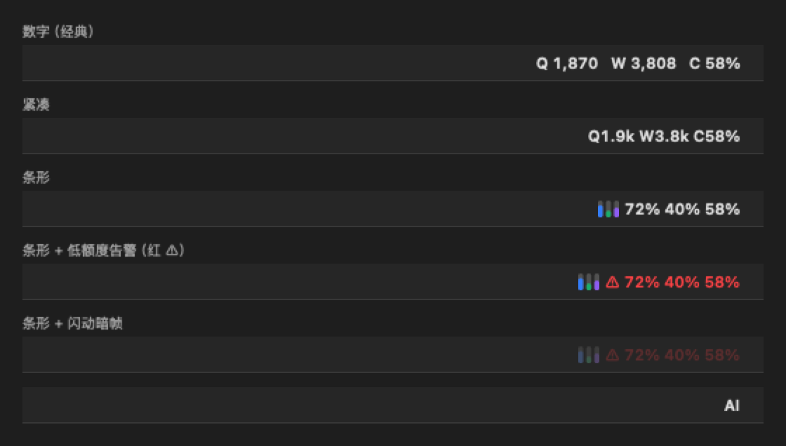 |

## 功能

- **菜单栏常驻**：紧凑显示关键指标（Qoder 剩余额度、WorkBuddy 剩余额度、Codex 已用比例），带完整 tooltip；新接入的 Claude Code 与 Trae 默认不占菜单栏，可在设置区「菜单栏」一行打开。
- **三种菜单栏样式**：`数字`（完整数值，默认）、`紧凑`（超千用 k 缩写省宽度）、`条形`（品牌色小竖条 + 剩余比例），设置区「样式」一行单选切换，立即生效并本地保存；告警高亮、待领取前缀与闪动在三种样式下都生效。数字与紧凑样式每 5 秒在剩余量与今日消耗之间滚动，今日那一拍带 `↓` 前缀，两拍按像素补位、切拍不跳位。
- **独立显示开关**：设置区可分别隐藏 / 显示五家的菜单栏入口；全部隐藏时仍保留一个 `AI` 入口，点击照常展开面板，数据也继续在后台采集。
- **全局快捷键**：`⌥⇧T` 在任意应用中展开或收起面板，不用去够菜单栏，也不需要辅助访问权限（走 Carbon 热键注册）；设置区「快捷键」一行可关闭，注册结果直接写在提示里。
- **自适应面板**：窗口高度跟着内容走——内容较短时弹窗同步收起，底部不再留一段空白；超过屏幕可用区域才整页滚动。五家卡片采用统一的五段布局（图标与名称 / 主数值 / 进度 / 洞察 / 脚注），高度对齐；正文最小字号 10pt，主数值 22pt 等宽数字。
- **三档显示密度**：快捷栏那颗按钮在 `常规`（全部细节）、`简单`（名称、套餐、主数值、一条进度条与今日消耗，隐藏洞察、预测与更新时间；今日消耗紧挨在剩余量后面并带 `↓` 标识，`3,715 ↘ 今日 102 · 昨天 247`）和 `极简`（一家一行收进一张容器：色条导轨、名称、主数值、剩余量胶囊、口径，只有余额没有分母的一家改画近 7 天迷你趋势线，页脚给最近更新时间与「几张卡片 / 已隐藏几张」；382×394pt 一屏看完五家，连关注摘要也压成一行）之间切换，设置区「界面」一行同样可单选，档位本地保存；简单与极简下本周汇总与次要比率都不占高度，告警与错误照常显示。
- **卡片拖动排序**：每张卡片右上角有一个抓手，按住上下拖到另一张卡片上松手即换位——拖过来的那张落到目标当时的槽位，其余依次补位；极简模式的整行都能拖。拖不动或想精确调整时，右键（或长按）卡片有「上移 / 下移 / 置顶 / 隐藏此卡片 / 恢复默认顺序」。顺序存在本地，面板卡片、本周汇总、标题行、菜单栏文字与条形、tooltip 逐行、设置区「菜单栏」「提醒」开关都按同一套顺序走；新接入的一家自动排在末尾，下架的残留记录会被忽略。
- **卡片显示与隐藏**：设置区「界面」下的「卡片」一行逐家开关，卡片右键也能一键隐藏；隐藏只是面板不占高度——采集、历史、告警、菜单栏与提醒都照常，重新显示回到原来的槽位。隐藏数存在 `ui.card.hidden`，极简页脚会写明「已隐藏 N」，全部隐藏后面板留一张「全部卡片都已隐藏」占位卡与「全部显示」按钮，不会白屏。
- **设置折叠**：菜单栏显示、提醒、智能预警与低额度阈值收进右上角齿轮，折叠时仅保留一行快捷栏（各组最近刷新时间、预警阈值开关、显示密度按钮、展开入口）。
- **详情面板**：套餐名称、额度进度条、剩余 / 总量、限额窗口、重置时间、最后更新时间与错误状态；Qoder 额外显示组织资源包（`剩余 1,800 / 2,000`），Codex 显示可领取的重置积分个数。面板里的「额度」就是官方页面上的 Credits，两家口径一致，只是换成中文显示。
- **用量洞察**：按本机历史采样估算今日消耗、昨天全天消耗与近 7 日日均；领取额度或窗口重置带来的增加不计入消耗，昨天整天没采满九成（合盖、刚装机）时不给参照值。
- **快捷入口**：每张卡片提供「打开」客户端与「官网」链接；Qoder CLI 未安装时「安装 CLI」一键下载官方安装包并在装好后自动发起登录，未登录时「登录」直接在浏览器完成授权，无需打开终端。
- **领取提醒**：Qoder 每天 10:00、WorkBuddy 与 Trae 每天 00:00 提醒领取当日额度（Trae 是 100 积分）；Codex 与 Claude Code 按最长限额窗口的重置时间提醒。五路可独立开关。
- **三层可见提醒**：额度告急与「今日待领取」不只发系统通知——菜单栏文字会变色加图标（告警红色 `⚠`、待领取橙色 `＋`），新提醒出现后闪动 60 秒（打开面板即停），面板顶部还有一条关注摘要列出原因、预计耗尽时刻与「打开客户端」。系统通知被关闭、勿扰模式或通知已划走都不再漏看。
- **趋势与耗尽预测**：每 5 分钟记录一次用量快照，展示近 7 天剩余曲线（额度制显示剩余额度，不受套餐总量变化影响）；Qoder / WorkBuddy / Trae 按「净日均消耗」估算额度耗尽时间——剔除每日领取 / 重置带来的增加，领取覆盖消耗时提示「按当前节奏不会耗尽」（历史不足 6 小时先积累样本）；Codex 按窗口长度选口径：周、月度这类天级以上的窗口只用近 7 天净日均，5 小时这类短窗口才用近 1 小时速率，然后与窗口重置时间比较，给出「可撑到重置」或预计耗尽时刻。Trae 只有余额、查不到周期总量，所以不画百分比，耗尽估算照给但按「剩余量 / 净日均」算。
- **本周汇总**：卡片下方一段「本周汇总」，逐平台给出本周消耗与上周对比（`400 额度 · 上周 32 额度`），细条按本周消耗占当前总额度的比例画分布；只统计剩余量的下降，领取与重置带来的增加不计入，上周完全没采样时不给对比。查不到总额度的 Trae 用本周与上周的较大值折算细条，鼠标悬停会说明「只表示趋势」。简单与极简模式或没有本周数据时整段不占高度。
- **智能预警**：低额度阈值可选 10% / 20% / 30%（默认 20%，持久保存），另有预计重置前耗尽、消耗突然加速两类本地通知，均可独立开关；额度制平台还能设「月度预算」，本月至今的净消耗超过预算绝对值即常驻告警（`本月已消耗 2,410 额度，超出 2,000 额度预算`），填 0 表示关闭。
- **通知快捷动作**：点击领取、重置或预警通知可直接打开对应客户端。
- **版本检查与升级**：每 24 小时自动检查 GitHub Releases，也可手动检查；发现新版本后自动匹配当前芯片下载 DMG，下载完成时按 Release 的 `SHA256SUMS` 资产（或说明中的「校验」表）比对 SHA-256。校验通过且应用正跑在 `/Applications/TokenTool.app` 时，按钮变成「安装并重启」：挂载 DMG、核对包内版本号、原子替换旧版本、失败自动回滚，然后重新启动，不需要再手动拖拽。其余情况（校验值缺失、从「下载」目录或 DMG 卷宗里运行）只会打开安装包或弹出确认，绝不静默替换自身。
- **CSV 导出**：面板底部「导出」可按 7 / 14 / 30 / 90 天选择范围导出用量历史，便于离线分析。
- **采集与本地数据兜底**：五家分开采集、各给各的超时预算（Codex 70 秒 / WorkBuddy 25 秒 / Qoder 80 秒 / Claude Code 75 秒 / Trae 20 秒），按刷新节奏分组并行、子进程退出用事件等待而非轮询，一家卡住不再拖累另外四家；超时、缺少 python3、输出结构变化这类问题按指数退避重试，原因直接写在卡片上。历史文件损坏时自动回退上一份备份，主文件改名留证后重新积累，不再出现「一觉醒来历史清零」；采集器输出按平台隔离解码，某一家字段变化不会把其他几家一起打回「无法解析」。
- **本地诊断日志**：采集失败、历史 / 缓存读写异常、告警触发与更新下载结果会写入已脱敏的本地日志（256 KB 自动轮换），面板底部「诊断」可一键在 Finder 中定位，排查问题时不必再靠猜。
- **开源信息**：面板底部展示当前版本、GitHub 源码与 MIT 许可证入口。
- **自动刷新**：Codex 与 WorkBuddy 每 60 秒，Qoder 每 90 秒（CLI 采集单次约 5 秒），Claude Code 与 Trae 每 120 秒；展开面板时若 Qoder 数据已超过 90 秒会立刻补采一次，先显示缓存值、采集回来就地更新。另支持手动刷新与系统唤醒后自动刷新。
- **本地缓存**：启动时先展示上次数据，再异步更新；历史快照保留 90 天。
- **开机启动**：面板一键开关，通过 LaunchAgent 实现，不产生 Dock 图标；开关状态读自 launchd 的实际注册结果，手动删掉 plist 或 `bootout` 之后面板不会继续显示「已开启」。
- **原生安装包**：分别提供 Apple Silicon（arm64）与 Intel（x86_64）安装包，另附通用二进制，最低 macOS 12。
- **应用图标**：三色环形仪表盘图标，安装后可在访达、启动台与 DMG 中识别。

## 界面说明

菜单栏默认用「数字」样式显示三家的关键指标（Claude Code 与 Trae 默认不占菜单栏，在设置区「菜单栏」一行打开后分别用 `A`、`T` 表示），可在面板中任意组合：

```
Q 1,770   W 12,480   C 8.5%
```

设置区「样式」一行可切换三种显示方式（单选，立即生效并本地保存）：

| 样式 | 效果 |
| --- | --- |
| `数字`（默认） | `Q 1,870   W 3,808   C 58%`：完整数值，最直观 |
| `紧凑` | `Q1.9k W3.8k C58%`：额度超千用 `k` 缩写，省出一段菜单栏宽度 |
| `条形` | 三根品牌色小竖条 + `72% 40% 58%`：竖条按剩余比例填充，只用比例不占宽度 |

「条形」左侧的竖条依次对应 Qoder（蓝）、WorkBuddy（绿）、Codex（紫），打开 Claude Code 与 Trae 后再各多一根橙棕色和青色竖条；底部灰色轨道表示该平台本期可用总量，数值取不到时只画空轨道。

「数字」与「紧凑」每 5 秒在剩余量与今日消耗之间滚动一次，今日那一拍带 `↓` 前缀（`Q ↓320` / `Q↓320`）：算不出今日消耗的平台继续显示剩余，两种含义靠箭头区分；所有显示中的平台都算不出时不滚动。每个平台按菜单栏字体实测宽度占位到两拍里较宽的一拍，多出的空格左右各分一半（`Q 2,649` ↔ `Q  ↓139 `），字母钉在组左端、数值在组内居中，切拍时后面的平台和整行宽度都不跳。「条形」表达的是剩余比例，不参与滚动，否则竖条和文案会各说一件事。

需要留意时同一行文字会带上状态前缀，颜色随之变化（优先级：告警 > 待领取 > 正常）：

```
⚠ Q 1,770   W 12,480   C 8.5%     # 红色：额度告急或预计重置前耗尽
＋ Q 1,770   W 12,480   C 8.5%     # 橙色：今日额度待领取 / 窗口即将重置
```

新出现的提醒会让菜单栏闪动 60 秒，之后保持常亮着色；打开一次面板即视为已知晓，不再闪动。设置区「注意力」一行可分别关闭 `高亮`（变色加图标）与 `闪动`，关闭高亮时菜单栏始终保持默认灰字，面板顶部摘要不受影响。

| 部分 | 含义 |
| --- | --- |
| `Q` | Qoder 剩余额度（套餐 + 附加额度） |
| `W` | WorkBuddy 剩余额度 |
| `C` | Codex 主限额窗口的已用比例 |

面板中每张卡片底部：

- **打开**：启动对应客户端（Qoder CN / WorkBuddy / ChatGPT / Claude Code / Trae CN）。
- **官网**：在浏览器打开官方站点。

面板默认只显示五张卡片与一行快捷栏；点右上角齿轮展开设置区，收起时设置不再常驻占位。快捷栏从左到右是各组最近刷新时间（三组节奏排不下时从中间省略，保留最快与最慢的一组）、`预警 30%` 开关（点击切换智能预警的启用状态，标签即当前低额度阈值）、跟随当前档位的显示密度菜单（`常规 / 简单 / 极简`）与「设置」入口。

有需要注意的事情时，标题下方会出现一条「关注摘要」：告警项在前、待领取项在后，每条写明平台、原因与时刻（例如「WorkBuddy 剩余 4%」「Codex 周窗口预计 3.2 小时后耗尽」「Qoder 今日 100 额度待领取」），右侧一键打开对应客户端。待领取项在检测到**今天**剩余额度或套餐总量出现过增加（即领取到账）后自动消失，从当天 00:00 起判定，提前或延后领取都不会误报；判定会直接比对最新一次采集值，所以领取后最多 90 秒提示就会收起，不必等 5 分钟的历史采样点。也可点「今天不再提醒」按天忽略（次日恢复）。点「静音 30 分钟」可临时收起摘要与菜单栏高亮，标题下方会留下「静音中，HH:mm 自动恢复提醒」与「取消静音」。

设置区「卡片」一行的五个眼睛按钮控制五张卡片在不在面板里出现，「菜单栏」一行的五个眼睛按钮控制菜单栏可见性，两处各管各的：藏起一张卡片不会让它从菜单栏消失，也不会关掉它的采集与提醒。状态立即生效并持久保存；一排放不下时自动换行，标签独占一行，宽度永远不超过面板。

「提醒」一行的五个铃铛按钮分别控制：

| 按钮 | 行为 |
| --- | --- |
| `Qoder 10:00` | 每天 10:00 提醒领取 100 额度 |
| `WorkBuddy 00:00` | 每天 00:00 提醒领取 100 额度 |
| `Codex 重置` | 在当前最长限额窗口重置时提醒 |
| `Claude Code 重置` | 在当前最长限额窗口（5 小时 / 本周）重置时提醒 |
| `Trae 00:00` | 每天 00:00 提醒领取 100 积分 |

这五个开关同时决定「关注摘要」里的待领取项：开启后，Qoder 过了 10:00、WorkBuddy 与 Trae 过了 00:00 仍没检测到今天有额度到账，就会以橙色 `＋` 提示待领取；Codex 与 Claude Code 在窗口重置前 20 分钟内提示即将重置。额度用满（剩余 = 总量）不影响判定，资源包过期导致的额度下降也不会被误当成已领取。Trae 只有余额、看不到总量，因此不参与待领取判定，只在提醒里给出「打开 Trae 领取今日积分」。

首次开启提醒或预警会请求系统通知权限；若系统通知被关闭，面板会显示提示和「去开启」入口。

「智能预警」一行的三个按钮：

| 按钮 | 行为 |
| --- | --- |
| `低额度` | 任一平台剩余比例降至阈值及以下时提醒（阈值可选 10% / 20% / 30%，默认 20%），恢复至阈值 +5% 以上后重新布防 |
| `重置前耗尽` | Codex 按预测速度（天级以上窗口用近 7 天净日均，短窗口用近 1 小时速率）预计会在限额窗口重置前用完时提醒 |
| `消耗加速` | 近 15 分钟消耗速度达到此前 1 小时的 2.5 倍以上时提醒 |

预警均为本机通知，并带冷却时间去重，避免短时间内重复弹出。低额度与重置前耗尽两类告警同时驱动菜单栏高亮与面板顶部的关注摘要，即使系统通知未授权或被划走也仍然看得见；「消耗加速」属于瞬时状态，只发通知。月度预算告警按平台、按月去重一次，并在面板顶部常驻一条，月初消耗清零后自动消失。Qoder / WorkBuddy 的耗尽预测与「净日均消耗」同口径：剔除每日领取、重置与套餐总量变化的影响，领取覆盖消耗时提示「按当前节奏不会耗尽」，样本不足时先显示「样本积累中」，仅供提前预警参考。

「月度预算」一行填的是额度绝对值（`0` 关闭），与低额度的百分比阈值各管一件事：前者盯「这个月已经花了多少」，后者盯「这一期还剩多少」。

Codex 的预测速度按窗口长度选择口径。周、月度这类天级以上的窗口只用「近 7 天净消耗折算时速」：一次 5 分钟的扣减若被近 1 小时回归放大成时速再外推到整月，会得出「日均 1.7%/天、剩余 77%，却只剩 3.5 天」这类自相矛盾的结论，长窗口按日均才与面板上的「近7日日均」一致。5 小时这类短窗口仍取「近 1 小时速率」与日均的较高者，保证突发使用时不被 7 天均值摊平而低估风险；历史不足 6 小时算不出日均时，退回近 1 小时速率。结论与窗口重置时间比较：撑得到重置显示「可撑到重置（月度）」，撑不到则给出预计耗尽时刻并触发预警；两者都接近 0（约低于 0.5%/天）才提示「近期无明显消耗」。悬停可见实际采用的口径与数值。

卡片底部会出现一条趋势行：左侧是近 7 天剩余曲线（Qoder / WorkBuddy 为剩余额度，Codex 与 Claude Code 为剩余比例），右侧是预测结论。历史数据不足（少于两个采样点）时暂不显示。

趋势行上方会显示「今日消耗 · 近 7 日日均」；日均至少需要 6 小时历史样本，数据不足时显示 `--`。

快捷栏下方是一段「本周汇总」：逐平台一行给出本周净消耗、上周同口径对比，以及一条按本周消耗占当前总额度比例画的分布细条。净消耗只累计剩余量的下降，因此每日领取、窗口重置与套餐总量变化都不会虚增本周用量；上周整周没采样时不显示对比，简单与极简模式下整段隐藏。取不到总额度的平台（Trae）按本周与上周的较大值折算细条，只表示趋势，悬停有说明。

### 显示密度、卡片顺序与显隐

快捷栏那颗按钮（设置区「界面」一行同样可选）在三档之间切换，档位存在本地：

| 密度 | 一张卡片里留下什么 | 演示数据下的面板高度 |
| --- | --- | --- |
| `常规`（默认） | 名称与套餐、主数值、进度条、今日消耗与近 7 日日均、趋势曲线与耗尽预测、更新时间与快捷入口 | 约 1848pt |
| `简单` | 名称与套餐、主数值加今日消耗、一条主要进度条；隐藏洞察、预测、更新时间与次要比率 | 约 1082pt |
| `极简` | 一家一行收进一张容器：色条导轨、名称、主数值、剩余量胶囊（只有余额的一家画近 7 天迷你趋势）、口径（剩余比例 / 窗口长度 / 单位），页脚给最近更新与张数；本周汇总与标题行不占高度，关注摘要压成一行 | 约 394pt |

三档都保留告警与错误提示，也都保留快捷栏、设置入口与底部操作，切回「常规」即可看到全部细节。

卡片顺序同样本地保存：按住卡片右上角的抓手拖到另一张卡片上松手即换位，极简模式整行可拖；拖不动就右键（或长按）卡片用「上移 / 下移 / 置顶 / 隐藏此卡片 / 恢复默认顺序」。这套顺序不只管面板——本周汇总、标题行、菜单栏文字与条形、tooltip 逐行、设置区「菜单栏」「提醒」开关都跟着走，新接入的一家排在末尾。

不想在面板里看到某一家，可以在设置区「界面 → 卡片」逐家关掉眼睛，或在卡片右键选「隐藏此卡片」。隐藏只把卡片从面板摘掉：这一家仍按原来的节奏采集、写历史、参与告警与提醒，菜单栏开关也照旧；重新打开时回到原来的槽位，不会因为藏过一次就掉到末尾。全部卡片都藏起来时面板留一张「全部卡片都已隐藏」的占位卡，点「全部显示」一次恢复，极简页脚也会写明「已隐藏 N」，不至于看着数字少了一屏找不到原因。

面板最底部：

| 元素 | 说明 |
| --- | --- |
| `v1.8.0` | 当前安装版本 |
| `GitHub` | 打开项目源码仓库 |
| `MIT` | 打开 MIT 许可证 |
| `导出` | 按 7 / 14 / 30 / 90 天范围把用量历史导出为 CSV 文件 |
| `诊断` | 在 Finder 中显示本地诊断日志（已脱敏，不含凭据与账号信息） |
| `已是最新 · HH:mm` / `重试检查` | 手动检查 GitHub Releases；失败时悬停可查看原因 |
| `检查于 x 前` | 最近一次检查更新的时间（自动与手动共用同一记录） |

### 版本与更新

- 应用启动后及面板打开时会检查更新，自动检查最多每 24 小时一次；底部按钮可随时手动检查。
- 优先请求 GitHub Releases API；若 API 被限流或不可用，会自动回退到发布页，不要求登录或 Token。
- 发现新版本时，面板顶部显示「新版本 x.y.z 可用」，并下载与当前芯片匹配的安装包：arm64 选 `-arm64.dmg`，Intel 选 `-x86_64.dmg`，找不到时使用通用 DMG。
- 安装包地址确定后，额外拉取该 Release 的 `SHA256SUMS` 资产解析校验值（网页回退路径同样可校验）；若该 Release 未提供 `SHA256SUMS`，则退回读取 Release 说明中的「校验」表。下载完成后比对 SHA-256：一致则标注「SHA-256 已校验」并把按钮换成「安装并重启」，不一致则删除安装包并提示；两者都取不到时保留安装包，但明确标注「SHA-256 未校验 · 需确认后才会打开」，点按会先弹出确认框，不再静默跳过。
- 「安装并重启」只做三件事：挂载 DMG、核对包内版本号确实是被下载的那一版、把 `.app` 原子换入 `/Applications`（旧版本先移到 `.previous`，替换失败就地回滚），最后卸载卷宗并重启应用。只有校验通过**且**当前就跑在 `/Applications/TokenTool.app` 里才会承诺这一步；从「下载」目录或 DMG 卷宗里运行时，按钮仍是「打开安装包」，应用不会替换一个自己都不确定在哪的副本，也避免 ad-hoc 签名应用的权限与 Gatekeeper 问题。
- 手动检查后，面板顶部会短暂显示检查结果（「已是最新版本 v x.y.z」或失败原因）与上次检查时间，可点「知道了」立即关闭；已是最新时底部按钮也会显示「已是最新 · HH:mm」。
- 更新检查遵循系统代理设置；若使用代理访问 GitHub，请确认「系统设置 → 网络 → 代理」已配置。
- 更新检查只读取版本号与安装包地址，不上传任何账号、额度或使用数据。

## 环境要求

| 项目 | 要求 |
| --- | --- |
| 系统 | macOS 12 Monterey 及以上 |
| 架构 | Apple Silicon（arm64）或 Intel（x86_64），提供独立安装包与通用版本 |
| Python | Python 3（系统 Command Line Tools 自带即可） |
| Qoder | 已单独安装官方 CLI `qoderclicn` 并完成登录（Qoder 客户端本身不含该 CLI） |
| WorkBuddy | 客户端已安装、已登录并保持运行 |
| Codex | ChatGPT.app 已安装并登录（内置 codex CLI） |
| Claude Code | 官方 `claude` CLI 已安装并登录（`claude /login`），订阅额度窗口才会出现在 `/usage` 里 |
| Trae | Trae CN 客户端已安装并登录，且在客户端里打开过一次额度面板（积分只写进客户端自己的日志，见「数据来源与隐私」） |

## 安装

### 从 Release 安装（推荐）

按 Mac 芯片选择对应安装包（DMG 与 ZIP 内容相同，任选其一）：

| Mac 类型 | 安装包 |
| --- | --- |
| Apple Silicon（M1 / M2 / M3 / M4…） | [`TokenTool-1.6.5-arm64.dmg`](https://github.com/pumf/token_tool/releases/download/v1.6.5/TokenTool-1.6.5-arm64.dmg) / [`.zip`](https://github.com/pumf/token_tool/releases/download/v1.6.5/TokenTool-1.6.5-arm64.zip) |
| Intel（x86_64） | [`TokenTool-1.6.5-x86_64.dmg`](https://github.com/pumf/token_tool/releases/download/v1.6.5/TokenTool-1.6.5-x86_64.dmg) / [`.zip`](https://github.com/pumf/token_tool/releases/download/v1.6.5/TokenTool-1.6.5-x86_64.zip) |
| 不确定 / 通用版本 | [`TokenTool-1.6.5.dmg`](https://github.com/pumf/token_tool/releases/download/v1.6.5/TokenTool-1.6.5.dmg) / [`.zip`](https://github.com/pumf/token_tool/releases/download/v1.6.5/TokenTool-1.6.5.zip) |

各安装包的 SHA-256 见同一 Release 下的 [`SHA256SUMS`](https://github.com/pumf/token_tool/releases/download/v1.6.5/SHA256SUMS)。

不确定芯片类型时，点击左上角苹果菜单 →「关于本机」，查看「芯片」一栏：Apple M 系列选 `arm64`，Intel 选 `x86_64`。

1. 下载与芯片匹配的 DMG 或 ZIP。
2. 打开 DMG，窗口里有 **TokenTool.app** 和一个「应用程序」快捷方式，把 TokenTool **拖到旁边的「Applications」图标上**；ZIP 则解压后把 TokenTool.app 手动拷进 `/Applications`。
   - 不要直接在 DMG 卷宗（或「下载」目录）里双击运行：那样应用每次都要重新授权、也不会覆盖已有安装，看起来像「装不上」。
   - 1.5.0 及更早的包内应用名带架构后缀（`TokenTool-x86_64.app` / `TokenTool-arm64.app`），拖进去会和已有的 TokenTool 并存而不是升级。若之前装过，先删掉 `/Applications` 里那个带后缀的副本，再装新版。
3. 首次启动若被 macOS 拦截（应用为本地构建，未使用 Developer ID 签名与公证），请：
   - 在「应用程序」中右键 TokenTool →「打开」→ 再次确认「打开」；或
   - 执行：
     ```bash
     xattr -dr com.apple.quarantine /Applications/TokenTool.app
     ```
4. 启动后应用只出现在菜单栏，不占用 Dock。
5. 首次启用提醒时，请在系统弹窗中允许通知。

### 从源码构建

依赖 Xcode Command Line Tools：

```bash
xcode-select --install
git clone https://github.com/pumf/token_tool.git
cd token_tool
./build.sh
open build/TokenTool.app
```

`build.sh` 会分别编译 `arm64` 与 `x86_64`，产出：

- `build/TokenTool-arm64.app`：Apple Silicon 原生版本
- `build/TokenTool-x86_64.app`：Intel 原生版本
- `build/TokenTool.app`：用 `lipo` 合并的通用版本

三个应用包均包含图标与采集器，并完成 ad-hoc 签名。

```bash
./test.sh    # 编译并运行回归测试（零依赖，无需 Xcode）
```

`Analytics.swift` 里的用量洞察与耗尽预测是最容易改坏的纯函数——领取回补不能算成消耗、天级以上的 Codex 窗口不能按小时速率外推、跨重置周期的样本要剔除。测试用固定时钟（当天 12:00）构造样本序列，逐条锁住这些口径；`Providers.swift` 注册表锁住既有的展示顺序、采集节奏与 UserDefaults 键名，卡片顺序与显隐（`Providers.order / moved / shifted / visible`）也在那里以纯函数锁定，`Persistence.swift` 锁住旧版 `cache.json` / `history.json` 的兼容读取；`Update.swift` 锁住安装包挑选（按芯片、只收 https 的 DMG、拒绝 zip 与校验文件）与「只有校验通过且装在 /Applications 才承诺安装并重启」这两道闸门，`Diagnostics.swift` 锁住脱敏规则——凭据要打掉，但「Claude Code 数据不可用」这类中文文案不能被误伤成乱码。本机没有 Xcode，Swift 侧用 `swiftc` 编成可执行文件跑；`collector.py` 的解析层用 `Tests/CollectorTests.py` 直接 import 后按官方输出样本断言（Qoder 的 `/usage` 面板文本、Codex 的窗口载荷、Claude 的两种窗口与 API 计费退化、Trae 的积分日志行（命中取值、时间戳解析、多窗口取最新、脏值剔除与目录缺失回退））。GitHub Actions 在每次 push / PR 上运行同一份 `test.sh`，并额外完成三架构打包。

如需产出发布用的安装包与校验文件：

```bash
./package.sh    # 依赖 ./build.sh 的产物，输出 build/dist
```

`package.sh` 会为三架构分别生成 DMG 与 ZIP（共六个文件），并在 `build/dist/SHA256SUMS` 中记录每个包的 SHA-256。应用内更新与该文件比对，发布时请一并上传到 Release。

安装到「应用程序」：

```bash
cp -R build/TokenTool.app /Applications/
open /Applications/TokenTool.app
```

## 数据来源与隐私

所有数据均在本机获取（官方客户端 / CLI / 本机 IPC，Trae 读它自己写到本机的额度日志），不上传任何用量或账号信息。

| 平台 | 采集方式 | 说明 |
| --- | --- | --- |
| Qoder | 官方 CLI `qoderclicn` 的 `/usage` 面板 | 通过伪终端自动进入会话并读取额度，不读取、不解密 Qoder 的加密登录文件，也不访问 Keychain |
| WorkBuddy | 本机 WBIPC 通道 | 与运行中的客户端完成本机握手后，调用其额度汇总接口，仅在本机通信 |
| Codex | ChatGPT.app 内置 `codex app-server` | 通过 JSON-RPC 调用 `account/read` 与 `account/rateLimits/read`，不直接读取登录凭据 |
| Claude Code | 官方 `claude` CLI 的 `auth status` 与 `-p /usage` | 只读取命令输出的限额窗口文字，带 `--no-session-persistence` 不留采集会话、`DISABLE_AUTOUPDATER` 不触发 CLI 自更新；不读取 `~/.claude` 下的凭据文件 |
| Trae | Trae CN 客户端自己写下的额度日志 | 见下方「Trae 的取数方式」，只匹配一行积分数字，不读整份日志、不读数据库、不访问 Keychain |

### Trae 的取数方式

Trae 目前没有对外提供的用量 CLI、app-server 或本机 IPC 通道，官方客户端也不暴露免凭据的查询接口，因此这一家是**唯一的例外**：读取客户端自己写到本机的额度日志。

- 读取范围限定在 `~/Library/Application Support/Trae CN/logs/<会话>/window*/renderer.log`，按修改时间从新到旧最多看 6 个文件，每个文件先读尾部 2 MB、没命中再顺序扫一遍。
- 只匹配 `[ICubeUsageService] credits mutation refresh completed {"…","remaining":N}` 这一行里的 `remaining` 数字与行首时间戳，**其余文本一律不读、不解析、不落盘**；日志里同批写出的其他字段（账号标识等）不会进入应用缓存、历史、诊断日志或截图。
- 时间戳取日志行自己记录的时间，所以数据比客户端面板滞后时会直接显示在「更新于」上；卡片里也写明了这一点。这个数字只在积分变动时写入，因此可能落后于 Trae 面板几十秒到几小时。
- 该格式不是公开契约，官方版本变化后可能失效；失效时卡片显示「Trae 日志里还没有积分记录」，「打开」与「官网」入口照常可用，不会伪造数值。
- 除这一家之外，其余四家仍严格走官方 CLI / 本机 IPC / app-server；任何一家都不会读取或输出登录凭据。

补充说明：

- 应用不会打印或保存 token、refresh token、密码、邮箱、UIN 等敏感信息。
- 提醒由 macOS 本地通知调度，不经过任何服务器。
- 版本检查仅访问 GitHub 的公开 Releases 页面 / API，不携带账号凭据或用量数据；安装包从 GitHub Releases 下载。
- 缓存与历史仅包含套餐、额度、百分比、时间戳等展示数据，路径为：
  ```
  ~/Library/Application Support/TokenTool/cache.json
  ~/Library/Application Support/TokenTool/history.json
  ~/Library/Application Support/TokenTool/history.json.bak
  ```
- 两个文件都带 `version` 字段，内容按供应商键存放；没有版本号的旧格式（固定三个键）仍然能直接读出，写出时才升级成新格式，升级或回滚都不会丢历史。
- `history.json` 每次覆盖前会轮换出 `history.json.bak`；主文件损坏时自动回退备份，坏文件改名为 `history.corrupt-<时间戳>.json` 保留供排查（只留最近两份），不会用空数据覆盖唯一证据。
- 诊断日志路径为 `~/Library/Application Support/TokenTool/logs/diagnostics.log`，只记录采集失败、历史 / 缓存读写异常、告警触发与更新下载结果；写盘前统一脱敏（token、授权链接参数、长串随机值），不含凭据、账号标识或额度明细。单文件上限 256 KB，超限自动丢弃前半段。
- 历史快照最多保留 90 天，用于趋势、本周汇总与耗尽预测；不包含任何账号凭据。
- 清除缓存：退出应用后删除 `~/Library/Application Support/TokenTool` 即可（缓存、历史与诊断日志都在其中）。
- 用量接口可能随官方客户端升级而变化；如遇读取失败，请先更新对应客户端或 CLI。

## 常见问题

| 现象 | 处理 |
| --- | --- |
| Qoder 提示「未登录」 | 点击卡片上的「终端登录」，或执行 `~/.local/bin/qoderclicn login` |
| Qoder 提示「未安装」但已装 Qoder 客户端 | 额度读取依赖独立的官方 CLI，Qoder 客户端本身不含它；点击「安装 CLI」或执行安装命令后刷新 |
| Qoder 提示「未安装」 | 点击「安装 CLI」查看官方文档，或执行 `curl -fsSL https://static.qoder.com.cn/qoder-cli-cn/install.sh \| bash` |
| Qoder 读取超时 | 确认 CLI 可在终端正常打开 `/usage`；首次运行需信任工作目录 |
| WorkBuddy 未运行 / 授权失效 | 打开 WorkBuddy 并重新登录，保持客户端运行后刷新 |
| Codex 提示未找到 CLI | 安装并登录 ChatGPT.app，确认 `/Applications/ChatGPT.app` 存在 |
| Claude Code 提示「按 API 计费，没有订阅额度窗口」 | `/usage` 只报本次会话花费，说明当前走的是 API key 或中继计费，没有订阅限额窗口；换成订阅登录即可显示 5 小时 / 本周两条窗口 |
| Claude Code 提示未找到 CLI | 安装官方 `claude` 命令（`npm i -g @anthropic-ai/claude-code` 或官方脚本），确认 `/opt/homebrew/bin/claude`、`/usr/local/bin/claude` 或 `~/.claude/local/claude` 之一可执行 |
| Trae 提示「未找到 Trae 日志」 | 本机没装 Trae CN，或装在了非默认位置；打开一次 Trae CN 并登录后刷新 |
| Trae 提示「日志里还没有积分记录」 | 在 Trae 里点开一次额度面板（积分数字只在积分变动时写日志），之后刷新即可；若 Trae 更新过日志格式，这一家会读不到，等下一版适配 |
| Trae 的数字和客户端对不上 | 属正常：这个数字来自客户端日志、只在积分变动时写入，会比面板滞后；卡片「更新于」显示的就是这条日志的时间 |
| 卡片拖不动 | 菜单栏面板里的拖拽可能被系统弹窗抢走焦点：改用右键（或长按）卡片菜单里的「上移 / 下移 / 置顶」，效果与拖动一致；抓手只在常规与简单模式出现在卡片右上角，极简模式整行可拖 |
| 想只看数字、不想看预测 | 快捷栏那颗密度按钮切到「极简」（设置区「界面」一行同样可选），五家一行一家、只剩色条与剩余量；切回「常规」即恢复全部细节 |
| 某一家不想在面板里出现 | 设置区「界面 → 卡片」关掉这一家，或右键卡片选「隐藏此卡片」。隐藏只摘面板卡片，采集、历史、告警、提醒与菜单栏都不受影响；藏过的顺序保留，重新打开回到原槽位 |
| 卡片全部隐藏后面板空了 | 面板会留一张「全部卡片都已隐藏」的占位卡，点上面的「全部显示」一次恢复；也可以从设置区逐家重新打开 |
| 刷新失败但仍有旧数据 | 卡片显示「上次成功」，数据保留，稍后手动刷新即可 |
| 卡片显示「采集超时」或「需要 python3」 | 先按提示排除环境问题再点「刷新」；连续失败会自动退避重试，失败细节可在底部「诊断」打开的日志里查看 |
| 菜单栏找不到应用 | 确认未全部隐藏（全部隐藏时显示 `AI`）；或重新启动应用 |
| 开机启动无效 | 面板开关读的是 launchd 的实际注册状态；若 `~/Library/LaunchAgents/com.local.tokentool.plist` 被手动删除或 `bootout` 过，开关会显示为关闭，在面板重新打开一次即可 |
| 没有收到提醒 | 在「系统设置 → 通知」中允许 TokenTool / AI 用量 的通知权限；面板出现提示时点击「去开启」 |
| 检查更新失败 | 确认网络或系统代理可访问 GitHub；应用在 API 限流时会自动回退发布页，稍后点「重试检查」即可 |
| 更新下载后如何安装 | SHA-256 校验通过且应用装在 `/Applications/TokenTool.app` 时，直接点「安装并重启」，替换与回滚都在应用内完成；其余情况（校验值缺失、从「下载」目录或 DMG 里运行）点按只会打开 DMG，需要手动把 TokenTool 拖入「应用程序」覆盖旧版本 |
| 已是最新但 Release 有更新 | 点击底部「已是最新」重新检查；若仍不生效，确认版本号大于当前安装版本 |

## 卸载

```bash
osascript -e 'quit app "TokenTool"'
rm -rf /Applications/TokenTool.app
launchctl bootout gui/$(id -u)/com.local.tokentool 2>/dev/null
rm -f ~/Library/LaunchAgents/com.local.tokentool.plist
rm -rf ~/Library/Application\ Support/TokenTool
defaults delete com.local.tokentool 2>/dev/null
```

## 项目结构

```
.
├── TokenToolApp.swift   # NSStatusItem + NSPopover 入口，无 Dock 图标
├── Providers.swift      # 供应商注册表：名称、口径、采集节奏、客户端与开关键名
├── Models.swift         # 采集结果与窗口数据模型（跨语言边界共用）
├── CollectorRunner.swift# 子进程采集：分组并行、超时与指数退避
├── UsageStore.swift     # 按供应商索引的数据状态、刷新调度、告警与提醒判定
├── Views.swift          # 菜单栏标签与详情面板视图
├── HotKey.swift         # 全局快捷键 ⌥⇧T（Carbon 注册，无需辅助访问权限）
├── Persistence.swift    # cache.json / history.json 的版本化读写与旧格式兼容
├── Analytics.swift      # 历史采样、趋势与耗尽预测、加速检测、用量洞察
├── Export.swift         # 用量历史 CSV 导出（7 / 14 / 30 / 90 天）
├── Update.swift         # GitHub Releases 版本检查、安装包匹配、下载校验与原子安装
├── Diagnostics.swift    # 本地诊断日志（脱敏、256 KB 轮换）
├── collector.py         # Codex / WorkBuddy / Qoder / Claude Code / Trae 本地数据采集器
├── AppIcon.icns         # 应用图标
├── LICENSE              # MIT 开源许可证
├── Info.plist           # 应用元数据（LSUIElement / 图标 / 版本号）
├── build.sh             # arm64 / x86_64 / 通用版本构建与 ad-hoc 签名
├── package.sh           # 产出六个安装包与 SHA256SUMS 校验文件
├── test.sh              # 编译并运行回归测试（Swift + Python 两侧）
├── Tests/               # 预测口径、注册表、数据格式、更新链路与 collector 解析层的回归测试
├── .github/workflows/   # CI：回归测试 + 三架构打包产物
├── docs/screenshots/    # README 界面截图（演示数据）
├── site/                # 宣传站（纯静态，无构建；webDirectory 就是它）
└── README.md
```

## 版本记录

### 1.8.0

> 尚未发布，Release 与安装包待单独发版。

- **接入第五家 Trae**：字节跳动的 Trae CN 是五家里唯一没有官方用量通道的——本机 127.0.0.1:17788 是登录用的 `SupabaseOAuthLocalServer`（要 `x-jwt-token`）、`/usr/local/bin/trae` 只是 IDE 启动器、`traecli` 没有用量命令且只对旗舰版开放、`agent-tool-host` 是工具沙箱。逐条排除后确认只剩一条路：官方客户端自己会把积分余额写进本机明文日志。经确认后按这一条接入，并且把它当作**整条「只走官方 CLI / 本机 IPC / app-server」规则的唯一例外**在 README 里写清楚。
- **只取一个数字，不读一份日志**：`collector.py` 按修改时间从新到旧最多看 6 个 `~/Library/Application Support/Trae CN/logs/*/window*/renderer.log`，每个先读尾部 2 MB、没命中再顺序扫一遍，只用一条正则抓 `credits mutation refresh completed` 里的 `remaining` 与行首时间戳。整行原文不进缓存、不进历史、不进诊断日志；负数与非数字直接丢弃，全部候选都脏时按失败返回，不编造余额。时间戳用日志自己记录的时间而不是采集时刻，所以滞后会直接显示在「更新于」上，卡片里也写明「仅在积分变动时更新，可能滞后于客户端面板」。本机实测单次 0.15 秒返回，形如 `{"ok": true, "remaining": 1200.0, "unit": "credits", "source": "trae-log", "updatedAt": …}`（示例值，非真实余额）。
- **只有余额、没有总量的一家**：`CreditLayout` 新增 `.balanceOnly`，卡片右侧显示「积分余额」而不是「剩余 / 共 N」，进度条按余额画、不谎报百分比。`Analytics.creditForecast` 原来在算不出百分比时整行预测都不出，现在把「百分比未知」与「额度不低」分开——Trae 的耗尽估算照给（余额 / 净日均），只是不给剩余比例。`creditUnit` 一路补进洞察、预测与本周汇总文案，Trae 读作「今日消耗 43 积分 · 近 7 日日均 36 积分/天」，其余四家仍是「额度」。
- **待领取判定不参与**：`dailyClaimItem` 要求同时拿到余额与总量，Trae 取不到总量，因此不会误报「今日 100 积分待领取」；到点通知（每天 00:00「打开 Trae 领取今日积分」）照常。
- **五家一排又把面板挤溢出**：设置区「菜单栏」「提醒」两行五个开关单行排开，理想宽度再次顶出 382pt，整块面板被居中挤到左边、两侧一起裁掉——和 1.7.0 修过的是同一个坑。改成 `LazyVGrid` 自适应网格（88–176pt 一列），放不下就换行，宽度永远不超过面板。离屏渲染逐行扫描六张图，左右边界稳定落在 13.5–368.0pt、`touchingRows=0`。
- **本周汇总对无总量平台改画趋势**：细条原本按「本周消耗 / 当前总额度」画，取不到总量时永远空条。现在退化为按「本周与上周较大值」折算，悬停说明「查不到总额度，进度条按本周/上周较大值折算，只表示趋势」，数字口径不变。
- **本地实跑发现：只有余额的一家根本进不了历史**。`UsageAnalytics.sample` 的守卫要求「有百分比或有窗口样本」，Trae 两者都拿不到，于是每次采集都被判成无效样本丢弃，`history.json` 里 Trae 永远 0 条——卡片只剩一个余额，日均与耗尽预测永远出不来（离屏渲染用的是手工造的样本，掩盖了这条路径）。守卫放宽为「有余额也记一条」，样本只带 `at` 与 `remaining`；重启后实测 `history.json` 出现 `{"at":…,"remaining":…}`。
- **本地实跑发现：编辑「月度预算」输入框会直接崩溃**（1.7.0 起就有，与 Trae 无关）。`monthlyBudget.didSet` 里 `monthlyBudget = max(0, monthlyBudget)` 无条件写回自己，而 `didSet` 对每次赋值都会再触发，SwiftUI 的 `TextField(value:format:)` 一提交就变成无限递归，栈溢出 `SIGSEGV`。改成只在确实需要夹紧时写回一次。用同一个探针分别在修复前后跑：修复前退出码 139（崩溃报告里 108 帧、连续 7 层 `monthlyBudget.didset`），修复后正常返回并把 `-3` 夹成 `0`。
- **卡片可以拖动排序**：每张卡片右上角加了一个抓手，`onDrag` 只携带供应商 id（`NSItemProvider` 里没有任何用量数据），落到另一张卡片上时按「取回那一刻」的槽位换位；菜单栏面板里的拖拽可能被系统弹窗抢焦点，所以同时给了右键菜单「上移 / 下移 / 置顶 / 隐藏此卡片 / 恢复默认顺序」兜底。顺序存在 `ui.card.order`，读取时与注册表合并——下架的残留忽略、新接入的排末尾；面板卡片、本周汇总、标题行、菜单栏文字与条形、tooltip、设置区的「菜单栏 / 提醒」开关共用这一套顺序。换位与越界钳制都写成 `Providers.moved / shifted / order(stored:)` 纯函数，测试不需要构造 `UsageStore`。
- **显示密度从两档变三档**：新增 `PanelDensity`（常规 / 简单 / 极简），`ui.density` 持久保存；没有 `ui.density` 时按旧的 `ui.simpleMode` 布尔迁移，老用户的开关状态不会在升级后复位。极简模式一家一行收进一张容器——色条导轨、名称、主数值、剩余量胶囊、口径，只有余额没有分母的一家改画近 7 天迷你趋势线，页脚交代最近更新时间与张数；标题行与本周汇总不占高度、关注摘要压成一行，演示数据下面板从 1848pt 降到 394pt。快捷栏那颗按钮改成跟随当前档位的菜单，设置区「界面」一行是三档单选。
- **卡片支持显示与隐藏**：`ui.card.hidden` 存隐藏名单，`Providers.hidden(stored:) / visible(_:hidden:)` 做过滤与清洗（只认注册表里的 id）。隐藏只从面板摘卡片：采集、历史、告警、提醒、菜单栏文字与 tooltip 都走完整顺序 `orderedProviders`，设置区的「菜单栏 / 提醒」开关因此不会因为藏起一张卡片就跟着消失；顺序本身不动，重新显示回到原槽位。全部隐藏时面板留一张带「全部显示」按钮的占位卡，极简页脚写明「已隐藏 N」，恢复默认顺序与显隐互不干扰。
- **测试**：Swift 侧注册表断言补到五家（顺序、`.credits` 口径、`menuBar.trae` / `reminder.trae.claim` 键名、默认不占菜单栏、120 秒分组、每日提醒文案与通知分类），并补「只有余额的一家也要留下样本」与卡片顺序 / 密度迁移 / 卡片显隐共 19 条，合计 255 项；`Tests/CollectorTests.py` 新增 Trae 日志行解析、目录扫描排序、尾部与全量回退、`collect_trae` 端到端（临时目录造日志，断言取最新窗口的值、`updatedAt` 来自日志、结果里没有 `total`、脏值回退到上一份文件、只有负数时判失败），共 95 项。
- **README 与截图**：功能、界面说明（「显示密度、卡片顺序与显隐」）、环境要求、数据来源与隐私（新增「Trae 的取数方式」）、常见问题都补到五家；面板图补到八张（常规 / 简单 / 极简各含深浅，另加设置与告警），全部用隔离 HOME 的合成数据重出，不含任何本机真实用量。

### 1.7.0

- **接入第四家 Claude Code**：走官方 `claude` CLI——`auth status` 判断登录、`-p /usage --output-format json --no-session-persistence` 读限额窗口。加 `--no-session-persistence` 是因为不带它每次采集都会在 `~/.claude/projects` 里留一个空会话；同时给子进程设 `DISABLE_AUTOUPDATER=1`，后台采集绝不能触发 CLI 自更新去改写用户的安装。窗口文案认「X% used / left / remaining」三种说法，重置时间认 `3:00 PM`、`Mon`、`in 2h 15m` 三种写法，认不出来就按「重置时间未知」显示。走 API key 或中继计费时 `/usage` 只报本次会话花费，此时明确降级为「Claude Code 按 API 计费，没有订阅额度窗口」，不硬凑一个 0%。新平台默认不占菜单栏，避免一升级就多出一项。
- **面板排版修到不再左右溢出**：加到四家之后，快捷栏的四组刷新时间各自 `fixedSize`，整行理想宽度顶出 382pt 的面板宽度，SwiftUI 把溢出的内容居中摆放，结果是整块面板左右各被切掉一截——「AI 用量」只剩「量」、`2,550` 显示成 `550`。快捷栏改成一段可中间截断的文本，设置区「菜单栏」「提醒」两行改为标签独占一行、四个开关整行铺开。离屏渲染按像素逐行核对卡片左右边界（正常应落在 28 / 736），确认六张截图无一行溢出。
- **升级从「打开 DMG 自己拖」变成「安装并重启」**：SHA-256 校验通过后，若应用正跑在 `/Applications/TokenTool.app`，按钮直接换成「安装并重启」——挂载 DMG、核对包内版本号、原子换入（旧版本先移到 `.previous`，失败就地回滚）、卸载卷宗再重启，全程不需要手动拖拽。校验值取不到时不再自动打开安装包，而是先弹确认框；跑在「下载」目录或 DMG 卷宗里时也只打开安装包，不承诺替换一个位置都不确定的副本。真实 Release 资产与真实 DMG 走完整挂载替换回滚流程验证过。
- **历史留到 90 天，新增本周汇总与导出范围**：`historyRetentionDays` 从 14 天提到 90 天，趋势仍看近 7 天、周对比才有上周可看；「本周汇总」逐平台给本周净消耗与上周对比，净消耗只累计剩余量的下降，领取与重置不计入。底部「导出」从固定 14 天改成 7 / 14 / 30 / 90 天可选。
- **月度预算告警**：低额度阈值看的是「这一期还剩多少百分比」，百分比在套餐总量变化时会失真；新增按额度绝对值设的月度预算，本月至今净消耗超过它就常驻一条关注摘要并发一次通知，按平台按月去重，月初清零自动消失，填 0 关闭。
- **全局快捷键 ⌥⇧T**：Carbon `RegisterEventHotKey` 注册，不需要辅助访问权限，在任何应用里都能开合面板；注册失败（如与其他应用撞键）把错误码写进面板提示而不是静默失效，设置区「快捷键」可关闭。
- **采集并行 + 去掉忙等**：按刷新节奏分组并行采集，子进程退出改用 readability handler 等事件，不再用 `usleep` 轮询占 CPU；一家卡住只消耗自己的超时预算。
- **开机启动状态读真的**：原来只看 `~/Library/LaunchAgents/com.local.tokentool.plist` 在不在，手动删 plist 或 `bootout` 之后面板仍显示「已开启」。现在直接问 launchd 该 label 是否已加载。
- **卡片补两处额度**：Codex 的重置积分个数（`重置积分 2 个`）与 Qoder 的组织资源包（`剩余 1,800 / 2,000`）以前只在 tooltip 里，现在直接上卡片。
- **拆掉 `Views.swift` 神文件**：3500 行单文件拆成 `Models.swift`（跨语言数据模型）、`CollectorRunner.swift`（子进程采集与退避）、`UsageStore.swift`（状态、调度与告警判定）和只留视图的 `Views.swift`，注册表驱动的 `ProviderDescriptor` 让新增一家平台不再需要改视图与统计代码。
- **诊断日志脱敏不再误伤中文**：旧规则里 `code[=: ]+\S+` 允许空格分隔且值取到 `\S+`，「Claude Code 数据不可用」整段被打码成 `Claude <redacted>`，日志反而看不懂。改成关键词后只吃「像凭据」的 ASCII 串，并单独处理 `Bearer xxx` 整段（否则只打掉前一个词，真凭据反而留下）。
- **测试补齐**：Swift 侧新增更新链路（按芯片挑包、只收 https 的 DMG、拒绝 zip 与校验文件、`canInstall` 四道闸门、版本比较）与脱敏规则断言，共 215 项；`collector.py` 的解析层新增 `Tests/CollectorTests.py`，按官方输出样本断言 8 组 69 项（Qoder 面板文本与组织资源包、Codex 窗口载荷夹取、Claude 两种窗口与 API 计费退化、注册表分组与窗口分钟数）。

### 1.6.5

- **菜单栏切拍宽度固定到像素**：1.6.2 起两拍按空格补位，但空格只能整颗补，每个平台四舍五入后最多差半颗空格，三家叠加后切拍瞬间整行仍会呼吸几个像素。应用侧占位改用 `NSAttributedString`：每个平台精确占两拍中较宽一拍的实测宽度，不足一颗空格的零头用 kern 加在最后一颗空格上（不足一颗时给负 kern 收缩），两拍总宽逐像素一致。本机真实数据实测：数字与紧凑两种样式两拍文字宽同为 158.50pt / 127.35pt，按钮宽 163.00pt / 132.00pt，Δ0.00pt。
- 纯排版改动：滚动节奏、字母钉组左端、数值组内居中的观感不变；按字符数估算的 `compose` 保留给测试与无字体环境，条形样式照旧不参与滚动。
- 新增真实菜单栏字体下两拍实测等宽的回归断言，154 项断言全绿。

### 1.6.4

- **单位名统一为「额度」**：面板、通知、预测文案里原来 Qoder 显示 `Credits`、WorkBuddy 显示「积分」，同一个数字两种叫法，看着像两家不同的口径。现在全部改成「额度」（`剩余 / 共 2,800 额度`、`今日消耗 149 额度 · 近 7 日日均 183 额度/天`、`额外额度`、`当前套餐未包含额度`、`今日 100 额度可领取`），`ProviderDescriptor.creditUnit` 两家同步改掉；官方页面上仍叫 Credits，README 功能一节里保留了这层对应关系。
- **只换文案不动数据**：采集字段、历史文件格式与 `Format.credits()` 这类内部标识不变，Codex 的百分比窗口（`creditUnit` 为空）不受影响；提醒标题去掉「今日 100 额度待领取」里多余的空格，读起来连贯。
- 供应商注册表与提醒文案的回归断言同步更新，152 项断言全绿；简单模式与详情面板各按本机真实数据重新出图，确认「额度」两处对齐、无截断。

### 1.6.3

- **昨日参照改成昨天全天**：1.6.2 的「昨天 X」取的是昨天 00:00 到昨天同一时刻，而用量按工作时段成片出现，于是早上会给出 `今日 102 · 昨天 4` 这种看着像坏数的数字（本机真实数据：昨天全天 247，但昨天午后才开工，到同一时刻只用了 4）。现在 `yesterdayConsumed` 取昨天 00:00 到今天 00:00 的整天消耗，卡片显示 `3,715 ↘ 今日 102 · 昨天 247`，和记忆里的昨天对得上；今日仍是 0 点至今，两个口径都写在鼠标提示里。
- **昨天是否采满改为累计可用样本对时长**：旧守卫只看首尾样本的时间跨度，中间合盖八小时也算「采满」。现在累计没被跳过（套餐总量与窗口重置没变）的样本对落在昨天内的时长，不足昨天全天的九成就不给参照——刚装机、昨天下午才开机会隐藏这段，而不是给一个偏小的数。跨零点的那一对按落在昨天内的比例计入昨天，不再出现两边都不算的空档。
- 重写 `runInsight()` 的三条昨日断言（昨天全天 1200、领取回补不计且跨零点对归昨天 700、昨天没采满不给参照），152 项断言全绿；简单模式面板按本机真实数据重新出图确认三家分别是 `今日 0 · 昨天 0`、`今日 102 · 昨天 247`、`今日 1.0% · 昨天 24%`。

### 1.6.2

- **菜单栏在剩余量与今日消耗之间滚动**：`数字` 与 `紧凑` 样式每 5 秒换一拍，今日那一拍带 `↓` 前缀（`Q ↓320` / `Q↓320`）；算不出今日消耗的平台继续显示剩余，三家都算不出时不滚动，`条形` 表达剩余比例所以不参与。每个平台按菜单栏字体实测宽度占位到两拍里较宽的一拍，多出的空格左右各分一半，字母钉在组左端、数值组内居中，切拍时后面的平台和整行宽度都不跳（真实数据下两拍项宽 159pt 对 159pt，此前会左右平移 12pt）。
- **简单模式的今日消耗并进主数值行**：`2,649 ↘ 今日 137`，更小字号加下降标识，三家卡片各省一行、面板矮约 57pt；后面再跟一段昨日同时段参照（`3,752 ↘ 今日 212 · 昨天 4`），单看今日也能判断多不多。
- **昨日同时段口径**：`UsageInsight` 新增 `yesterdayConsumed`，取昨天 00:00 到昨天同一时刻的消耗，跨窗口边界的样本对按落在该时段内的比例折算，领取与重置带来的增加不计；昨天那段没采满九成（合盖、刚装机）时不给参照值，避免用一个偏小的数字误导对比。
- 新增菜单栏组合（两拍行宽一致、补位分配）、昨日折算与覆盖守卫的回归断言；常规模式面板与 1.6.1 逐像素相同，简单模式的差异只落在新增的「· 昨天 X」那一段。

### 1.6.1

- **供应商行为收进一张注册表**：三家供应商的名称、口径、采集节奏、客户端 bundle id 与开关键名此前散落在面板、调度、通知和 `collector.py` 的显式分支里，加一家要同时改四五处。现在统一到 `Providers.swift` 的描述符，界面按 `quotaKind`（积分 / 百分比窗口）分派、采集按刷新间隔分组共用定时器，面板文案、采集顺序、通知内容和本机设置键名逐一比对过旧实现，保持一致。
- **本地数据升到 v2**：`cache.json` 与 `history.json` 带 `version` 字段，旧格式按固定键读取后自动改写，未识别的键忽略并写诊断日志，读旧写新不丢历史。
- **安装包可直接拖入「应用程序」**：三个架构的 DMG 与 ZIP 内统一为 `TokenTool.app`，并附上「Applications」快捷方式；此前 Intel 包内是 `TokenTool-x86_64.app` 且没有拖拽目标，只能双击直接运行。打包前增加一次 `codesign --verify` 校验。
- 新增供应商注册表、本地数据读写与 CSV 导出的回归断言，面板折叠/展开、深浅色与告警态与上一版逐像素相同。

### 1.6.0

- **三种菜单栏样式可切换**：设置区新增「样式」一行，可在 `数字`（完整数值，默认）、`紧凑`（超千用 `k` 缩写）与 `条形`（品牌色小竖条 + 剩余比例）之间单选切换，立即生效并持久保存。条形样式显式绘制 1x/2x 位图，Retina 菜单栏不糊；告警红色 `⚠`、待领取橙色 `＋` 与闪动在三种样式下都生效。
- 设置区顺序微调：「样式」放在「菜单栏」显示开关之前，先选外观再选平台。

### 1.5.0

- **面板高度跟随内容**：弹窗尺寸按内容实际高度设置，不再固定撑到屏幕可用高度。收起设置、提醒消失、切到简单模式后，下方不会再留一段空白；内容超过屏幕时仍然整页滚动。
- **简单模式**：快捷栏新增「简单」开关（设置区「界面」一行也有），三张卡片只保留名称、套餐、主数值与一条主要进度条，隐藏洞察、预测、更新时间与次要比率；出错与低额度提示仍会照常显示。演示数据下面板从约 880pt 降到约 650pt，开关状态本地保存。
- 快捷栏的「更多设置」改名为「设置」，为简单模式开关腾出位置。

### 1.4.9

- **历史不再因单个坏文件清零**：`history.json` 每次写入前轮换一份 `history.json.bak`；主文件读不出时自动回退备份，同时把坏文件改名成 `history.corrupt-<时间戳>.json` 留证（只留最近两份），不会再出现「写入时把唯一的历史覆盖成空数组」。
- **采集输出按平台隔离解码**：Codex / WorkBuddy / Qoder 分别解析，某一家字段改名或类型变化只让这一家降级为「部分未知」，不再让整份 JSON 解码失败、把另外两家一起打回「无法解析」；采集器版本号不符时直接提示升级应用。
- **采集子进程不再泄漏**：超时分支过去直接 return，每次超时都留下一个僵尸子进程和两个未关闭的文件句柄；现在统一先 TERM 再 KILL 并收尸，句柄与临时文件在 `defer` 里清理。失败原因也从统一的「采集超时」细化为超时秒数、缺少 python3 / 命令行工具、退出码与 stderr 摘要。
- **分开的采集预算**：Codex 与 WorkBuddy 不再共用一次 80 秒预算，改为各自采集（Codex 70 秒、WorkBuddy 25 秒），Codex 卡住时 WorkBuddy 仍能按时刷新；环境类失败按指数退避重试（最长 15 分钟），不会每 60 秒反复重开子进程。
- **隐私安全的本地诊断日志**：采集失败、历史 / 缓存读写异常、告警触发与更新下载结果写入 `logs/diagnostics.log`，写盘前脱敏，单文件 256 KB 自动轮换；面板底部新增「诊断」入口，一键在 Finder 中定位。

### 1.4.8

- Qoder 自动刷新从 5 分钟缩短到 90 秒（单次 CLI 采集实测约 5 秒，原先的间隔过于保守），领取或消耗后不必再等几分钟才反映到面板。
- 展开面板时若 Qoder 数据已超过 90 秒会立刻补采一次：先显示缓存值，采集回来就地更新，不用手动点刷新。
- 「今日额度待领取」的判定直接比对最新一次采集值，不再等下一个历史采样点，领取后提示最多 90 秒收起；全新安装没有跨日基线时用当天首个样本兜底。
- 历史采样仍保持 5 分钟一个点，避免刷新变密后把 14 天的样本上限撑满、把曲线压短。

### 1.4.7

- 修复 Qoder「今日 100 Credits 待领取」不再触发：旧判定要求「剩余 < 总量」，而资源包过期时今日已用会清零、剩余重新等于总量，于是被当成「没东西可领」而整天静默（WorkBuddy 正常，只有 Qoder 受影响）。
- 待领取判定改为只看「今天是否出现过额度到账」：剩余或套餐总量相对前一个样本有任何增加即视为已领取，判定窗口从当天 00:00 起算，提前或延后领取都能正确让提示消失。
- 资源包过期、每日消耗造成的下降不再影响判定；额度用满（剩余 = 总量）也不会再误判为无需领取。

### 1.4.6

- 修正 Codex 月度、周这类天级以上窗口的耗尽预测：不再把「近 1 小时速率」外推到整月。此前一次 5 分钟的扣减经线性回归放大成时速后，会出现「近7日日均 1.7%/天、剩余 77%，却提示只剩 3.5 天」的自相矛盾结论；长窗口现在一律按近 7 天净日均估算，与面板上的日均口径一致。
- 5 小时这类短窗口保持按小时速率预警；只有历史不足 6 小时算不出日均时才退回近 1 小时速率，悬停文案会写明本次采用的是哪条口径。
- 「可撑到重置」的悬停文案改为给出日均口径与重置时刻，不再列出一个晚于重置的耗尽时间。

### 1.4.5

- 提醒不再只依赖系统通知，改为三层同时可见：菜单栏文字着色加 `⚠` / `＋` 前缀、新提醒闪动 60 秒（打开面板即停）、面板顶部的「关注摘要」列出平台、原因与时刻并可一键打开客户端。
- 积分领取也纳入同一套提醒：Qoder 过了 10:00、WorkBuddy 过了 00:00 若未检测到今日额度增加则以橙色「待领取」提示，领取成功后自动消失；Codex 在限额窗口重置前 20 分钟内提示即将重置。支持「今天不再提醒」按天忽略与「静音 30 分钟」（含取消静音）。
- 低额度与重置前耗尽两类告警在系统通知未授权、勿扰或通知已被划走时依然可见；「消耗加速」仍只发通知。
- 设置区新增「注意力」一行，可分别关闭菜单栏 `高亮` 与 `闪动`，状态持久保存。

### 1.4.4

- Codex 耗尽预测并入净日均口径：速度取「近 7 天净消耗折算时速」与「近 1 小时速率」中较高者，隔几天集中使用一次也能给出「可撑到重置」或预计耗尽时刻，不再因为最近一小时没动就显示「近期无明显消耗」；突发使用时仍按小时速率给出及时预警。
- 预测悬停文案改为同时给出两条速度（近 1 小时 %/小时、近 N 天净消耗 %/天），慢速消耗不再被四舍五入成「0%/小时」。
- 「近期无明显消耗」只在近 1 小时与近 7 天净消耗都接近 0（约低于 0.5%/天）时出现。

### 1.4.3

- Qoder CLI 可一键安装：未检测到官方 CLI 时，「安装 CLI」直接下载并执行官方安装脚本，装好后自动发起登录，全程无需打开终端；登录中 / 失败状态在卡片上实时提示，失败可「重试登录」或转终端处理。
- 详情面板风格重构：三家卡片改为统一的五段布局并对齐高度；正文最小字号提升到 10pt、主数值 22pt 等宽数字；圆角与间距统一为设计令牌；品牌色只用于图标与进度条，错误改为单条状态提示。
- 菜单栏显示、提醒、智能预警与低额度阈值收进齿轮设置区，折叠时保留一行快捷栏。
- 趋势曲线补充零基线与「今日」虚线，区域填充更淡；修复积分量级下曲线被 100 上限压平的问题。
- 更新校验不再静默跳过：安装包地址确定后额外拉取该 Release 的 `SHA256SUMS` 资产，网页回退路径同样可校验；取不到校验值时明确标注「SHA-256 未校验」。
- 手动检查更新有可见反馈：面板顶部短暂显示检查结果与上次检查时间，底部按钮显示「已是最新 · HH:mm」，并常驻「检查于 x 前」。
- 新增 `package.sh`：一条命令产出三架构 DMG + ZIP 共六个安装包与 `SHA256SUMS` 校验文件。

### 1.4.2

- Qoder CLI 查找范围扩大：除 `~/.local/bin` 与 `~/.qoder-cn/bin` 外，额外搜索 `/usr/local/bin`、`/opt/homebrew/bin`，并补全 GUI 启动时缺失的 PATH，避免已安装 CLI 仍被判定为未安装。
- 已安装 Qoder 客户端但未安装官方 CLI 时，提示明确区分两者（客户端本身不含额度接口），「安装 CLI」按钮保持不变。
- CLI 文件存在但不可执行时，提示中给出具体路径便于排查权限问题。

### 1.4.1

- 耗尽预测改为按「净日均消耗」计算：剔除每日领取 / 重置带来的增加与套餐总量变化干扰，领取覆盖消耗时提示「按当前节奏不会耗尽」。
- 日均消耗改按实际观察时长折算，跨零点或不足整天时不再被稀释成多天。
- 趋势曲线改为绘制剩余 Credits，套餐总量变化不再造成曲线假跳变。
- 低额度阈值可在 10% / 20% / 30% 间切换（默认 20%），并持久保存。
- 更新安装包下载完成后自动校验 Release 说明中的 SHA-256，校验失败自动删除并提示。
- 菜单栏 tooltip 追加各平台预测结论。
- 新增 CSV 导出：面板底部「导出」按钮可导出近 14 天用量历史。
- 历史样本不足 6 小时时预测显示「样本积累中」，并在 tooltip 标注估算口径与已观察天数。

### 1.4.0

- 新增自适应详情面板：按屏幕可用高度调整，小屏自动滚动，底部设置不再被裁切。
- 新增用量洞察：展示今日消耗与近 7 日日均，领取或重置带来的增加不计入消耗。
- 新增版本检查与升级：每 24 小时自动检查 GitHub Releases，也可手动检查；自动匹配 arm64 / x86_64 / 通用安装包并打开 DMG。
- GitHub API 限流或不可用时自动回退到发布页，更新检查无需登录或 Token。
- 面板底部新增当前版本、GitHub 源码与 MIT 许可证入口。
- 项目以 MIT License 开源，补充版本与开源信息。
- arm64、x86_64 与通用包同步更新。

### 1.3.1

- 最低系统要求从 macOS 13 降至 macOS 12 Monterey。
- 菜单栏入口由 SwiftUI `MenuBarExtra` 改为 AppKit `NSStatusItem + NSPopover`，功能与面板内容不变。
- arm64、x86_64 与通用包同步更新。

### 1.3.0

- 新增近 7 天用量趋势曲线与额度耗尽时间预测。
- 新增低额度、重置前耗尽、消耗加速三类智能预警，均可独立开关。
- 通知支持快捷动作，点击后直接打开对应客户端。
- 历史快照保留 14 天，用于趋势和预测；不记录任何账号凭据。

### 1.2.1

- Qoder 与 WorkBuddy 的菜单栏和详情改为显示积分数值，不再显示百分比。
- WorkBuddy 菜单栏积分改为完整数值（如 `3,523`），不再使用 `3.5k` 缩写。
- 新增应用图标：深色圆角底、三色环形仪表盘与白色指针。
- 新增 Apple Silicon（arm64）与 Intel（x86_64）独立安装包，同时保留通用版本。

### 1.2.0

- 新增领取提醒：Qoder 每天 10:00、WorkBuddy 每天 00:00，Codex 按限额窗口重置时间提醒。
- 三路提醒可独立开关，状态持久化；系统通知未授权时面板提供开启入口。
- 提醒通过 macOS 本地通知调度，不依赖服务器。

### 1.1.0

- 新增 Qoder / WorkBuddy / Codex 菜单栏独立显示开关，状态持久化。
- 全部隐藏时保留 `AI` 入口，面板与数据采集不受影响。
- 每张卡片新增「打开」客户端与「官网」快捷链接。
- Qoder 未登录 / 未安装时提供「终端登录」「安装 CLI」快捷操作。
- 修正 ChatGPT.app 的 Bundle ID（`com.openai.codex`）。

### 1.0.0

- 首个版本：菜单栏展示三家额度，详情面板、自动刷新、开机启动、本地缓存。

## 开源许可

本项目采用 [MIT License](LICENSE) 开源。

| 项目 | 地址 |
| --- | --- |
| 源码仓库 | <https://github.com/pumf/token_tool> |
| 问题反馈 | <https://github.com/pumf/token_tool/issues> |
| 版本发布 | <https://github.com/pumf/token_tool/releases> |
| 当前版本 | 1.8.0（build 24，尚未发布） |

欢迎提交 Issue 与 Pull Request。应用内的「检查更新」会读取 GitHub Releases 的最新版本，不会上传任何本地数据。

## 免责声明

本项目为非官方工具，与 Qoder、WorkBuddy、OpenAI、Anthropic、字节跳动（Trae）无隶属关系。数据读取依赖各官方客户端 / CLI 的本地接口，接口变更可能导致暂时不可用；请以官方客户端显示为准。
