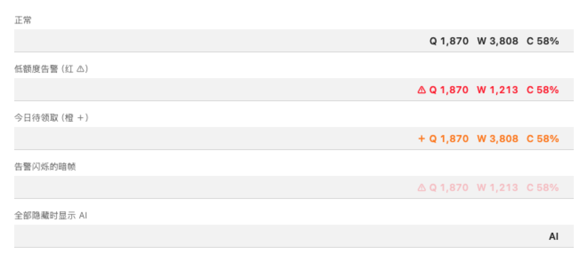
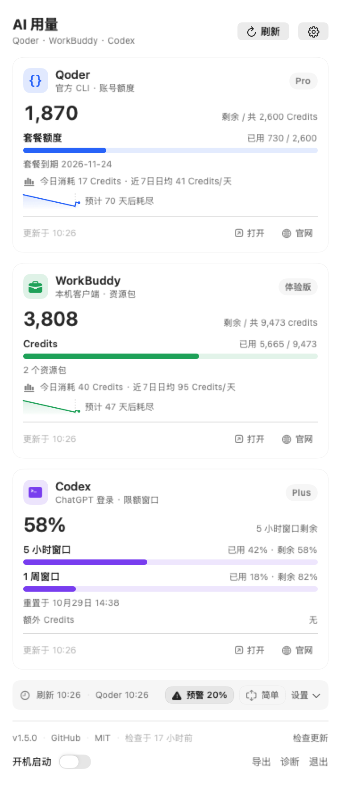
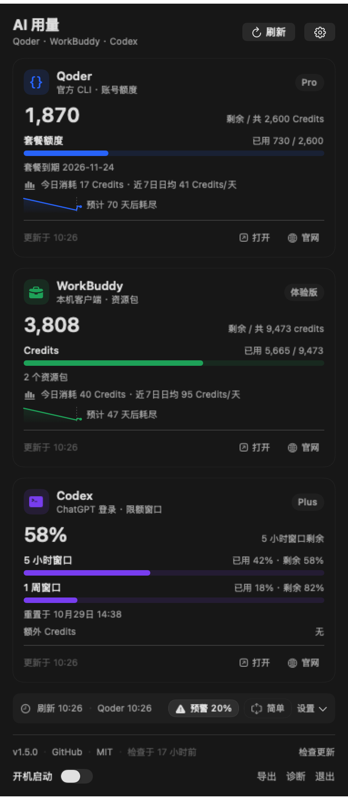
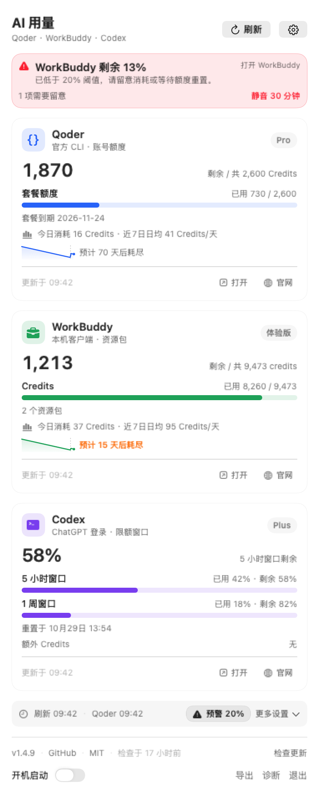
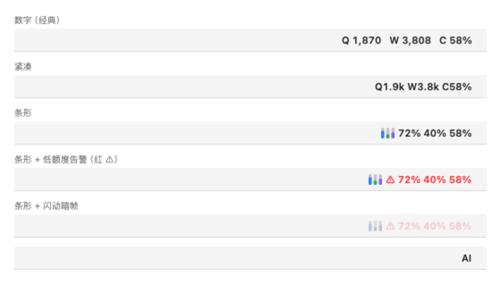
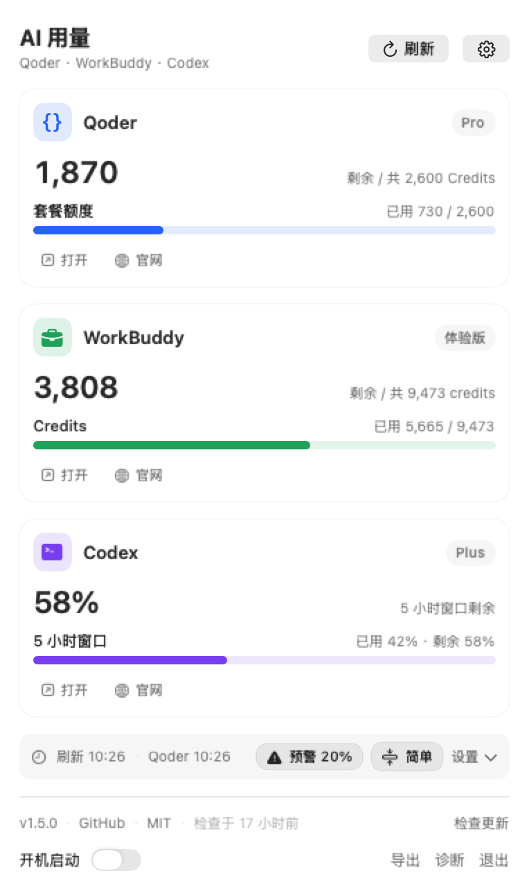
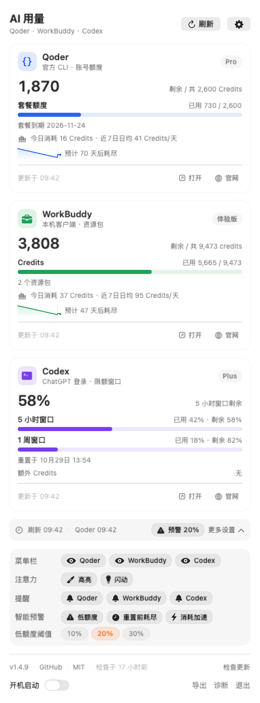

# 你的 AI 额度还剩多少？别再一个个客户端点开猜了

> **TokenTool** —— macOS 菜单栏上的 AI 用量仪表盘，Qoder、WorkBuddy、Codex 三家额度，一瞥尽知。

**GitHub 开源（MIT）**：https://github.com/pumf/token_tool

---

## 一个每天都会遇到的尴尬

用 AI 编程工具干活，最怕的不是写不出代码，而是写着写着额度没了：

- 「我今天到底用了多少 Credits？」
- 「Qoder 什么时候会耗尽？撑不撑得到月底？」
- 「Codex 的 5 小时窗口几点重置？」
- 「今天 100 额度领了吗？」

想知道答案，你得打开 A 的面板、点开 B 的官网、终端里再敲一遍 C 的命令——三个平台、三种口径、三遍重复。

**TokenTool 把这件事压缩到菜单栏的一瞥。**

## 三家额度，常驻菜单栏

装好之后，菜单栏右上角会多出几个小小的数字：Qoder 剩余积分、WorkBuddy 剩余积分、Codex 已用比例。不用打开任何窗口，扫一眼就知道还能放心写多久。

菜单栏不只是静态数字，它会自己「说话」：

- 🟢 正常显示剩余 / 已用比例
- ⚠️ **红色告警**：某家额度低于预警阈值（默认 20%）
- ➕ **橙色提示**：今天有额度还没领
- ✨ 新告警出现后闪动 60 秒提醒你注意（点开面板即停）
- 三家都隐藏时，仍保留一个 `AI` 入口，点击照常展开面板

## 点开面板，每家一张卡

点击菜单栏，展开一个轻量详情面板。没有 Dock 图标，没有后台常驻窗口，用完即收。

每张卡片都包含你关心的全部信息：

- **主数值**：剩余 Credits 或窗口剩余比例，22pt 等宽数字，一眼读数
- **进度条**：套餐额度用了多少，剩了多少
- **洞察**：今日消耗、近 7 日日均
- **耗尽预测**：按你的真实消耗节奏，估计额度还能撑几天
- **快捷入口**：一键打开客户端或官网

## 用了多久？还能撑几天？它帮你算好了

这是 TokenTool 最有意思的部分——**预测不是拍脑袋**。

每 5 分钟记录一次用量快照，积累近 7 天历史，然后：

- **Qoder / WorkBuddy（积分制）**：按「净日均消耗」估算耗尽时间。每天自动领取的 100 额度会被剔除，不会假装成「省下来的用量」；如果领取覆盖了消耗，它会直接告诉你「按当前节奏不会耗尽」
- **Codex（窗口制）**：分窗口长短选口径——周、月度这类天级以上的窗口按近 7 天净日均推算；5 小时这类短窗口才按近 1 小时速率外推，避免短窗口被长趋势误导。然后和重置时间比较，告诉你「可撑到重置」还是预计几点耗尽

面板底部还有近 7 天的剩余曲线（积分制画剩余 Credits，不受套餐总量变化影响），趋势变化一目了然。

## 额度告急？三重提醒，不靠运气

系统通知很容易被划走、被勿扰模式吞掉。TokenTool 的提醒有三层：

1. **菜单栏变色 + 图标**：告警红色 `⚠`、待领取橙色 `＋`，不点开任何东西就能看到
2. **面板顶部摘要条**：列出告警原因、预计耗尽时刻，附「打开客户端」直达入口
3. **系统通知**：照常发送，点通知可直接打开对应客户端

每日领取提醒也是分开的：Qoder 每天 10:00、WorkBuddy 每天 00:00 提醒领取 100 额度，Codex 按限额窗口的重置时间提醒，三路各自可开关。

## 花哨还是精简？你说了算

**三种菜单栏样式**，设置区一行切换、立即生效：

- **数字**：完整数值（默认）
- **紧凑**：超千自动缩写成 k，省宽度
- **条形**：品牌色小竖条 + 剩余比例，最轻量

面板这边，**简单模式**让三张卡片只保留名称、套餐、主数值、一条进度条和今日消耗，适合「只想瞄一眼」的场景：

想细看的时候，所有洞察、预测、更新时间都还在。

## 设置收进一个齿轮，不占地方

菜单栏显示、提醒、智能预警、低额度阈值（10% / 20% / 30%）全部收进右上角齿轮，折叠时只留一行快捷栏。每家平台可以独立决定是否显示在菜单栏，互不打扰。

## 它怎么拿到数据？

只走**官方通道**：Qoder 走官方 CLI，WorkBuddy 走本机客户端 IPC，Codex 走本机 app-server。**不读取、不存储任何登录凭据**，所有数据只保存在你自己的电脑上。

Qoder CLI 未安装时，「安装 CLI」会一键下载官方安装包并自动发起登录；未登录时「登录」在浏览器完成授权，全程不用碰终端。

## 为「稳定」做的那些事

一个后台采集工具最怕两件事：采集卡死和数据丢失。TokenTool 都处理了：

- **三家分开采集、独立超时**（Codex 70s / WorkBuddy 25s / Qoder 80s），一家卡住不拖累另外两家；失败按指数退避重试，原因直接写在卡片上
- **历史文件损坏自动兜底**：回退上一份备份、主文件改名留证后重新积累，不会「一觉醒来历史清零」
- **采集器输出按平台隔离解码**：某一家字段变了，不会把其他两家一起打回「无法解析」
- **本地诊断日志**：脱敏后写入本地（256 KB 自动轮换），面板底部「诊断」一键定位，排查问题不用猜
- **CSV 导出**：近 14 天用量历史随时导出，离线随便分析

## 内置升级，装一次管到底

应用每 24 小时自动检查 GitHub Releases。发现新版本后自动匹配当前芯片下载 DMG，按 Release 的 `SHA256SUMS` 比对校验，通过后自动打开安装包——拖进「应用程序」就完成升级。取不到校验值时会明确标注「SHA-256 未校验」，绝不静默安装来源不明的包。

## 开箱即用

- macOS 菜单栏常驻，无 Dock 图标
- 自动刷新：Codex / WorkBuddy 每 60 秒，Qoder 每 90 秒
- 启动先展示缓存数据，后台异步更新
- 开机启动一键开关（LaunchAgent）
- MIT 开源，当前版本 1.6.0

**下载**：到 [Releases 页面](https://github.com/pumf/token_tool/releases) 下载对应芯片的 DMG（内置 Intel / Apple Silicon / 通用三版），拖进「应用程序」即可。

---

> 把「还有多少额度」这个每天问好几遍的问题，交给菜单栏上的一个小数字。
> **TokenTool**：https://github.com/pumf/token_tool ⭐ 觉得有用的话，给个 Star 是对独立开发者最好的鼓励。
